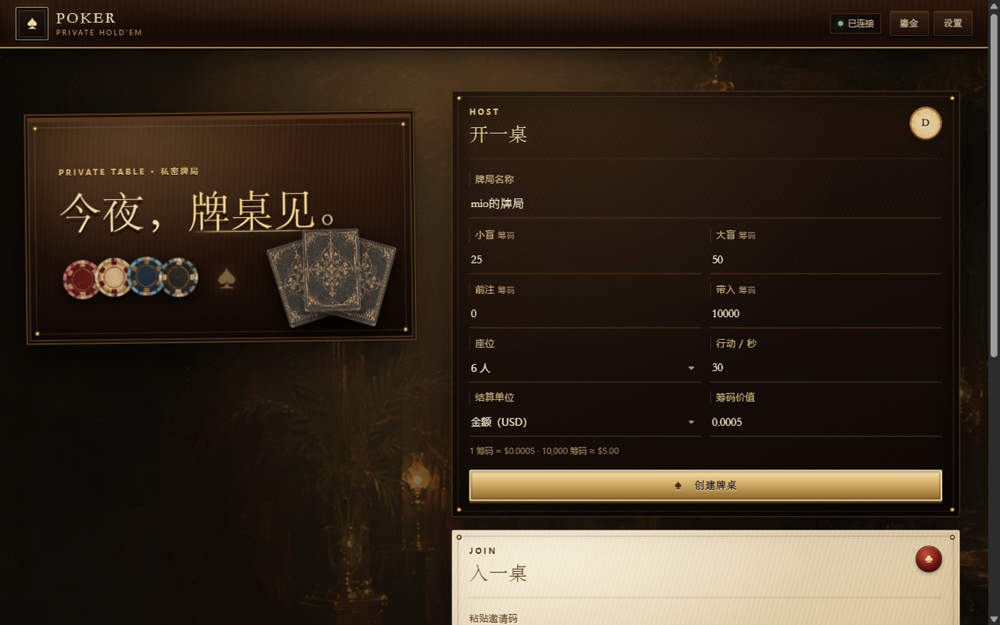
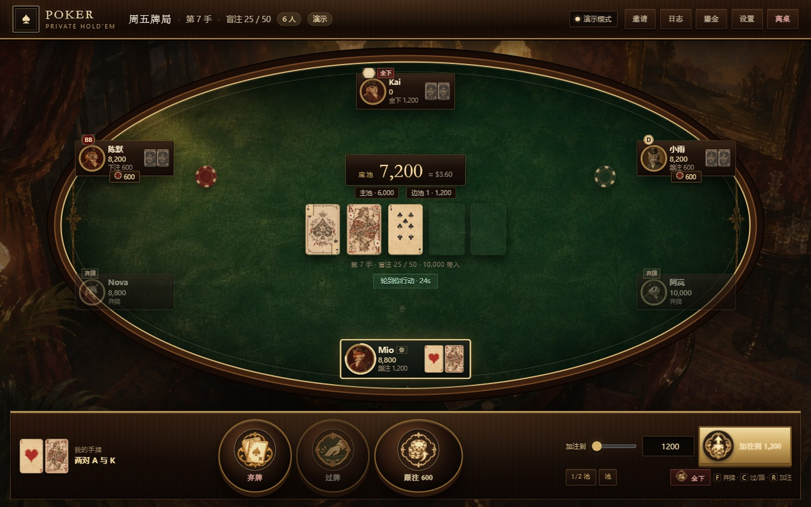
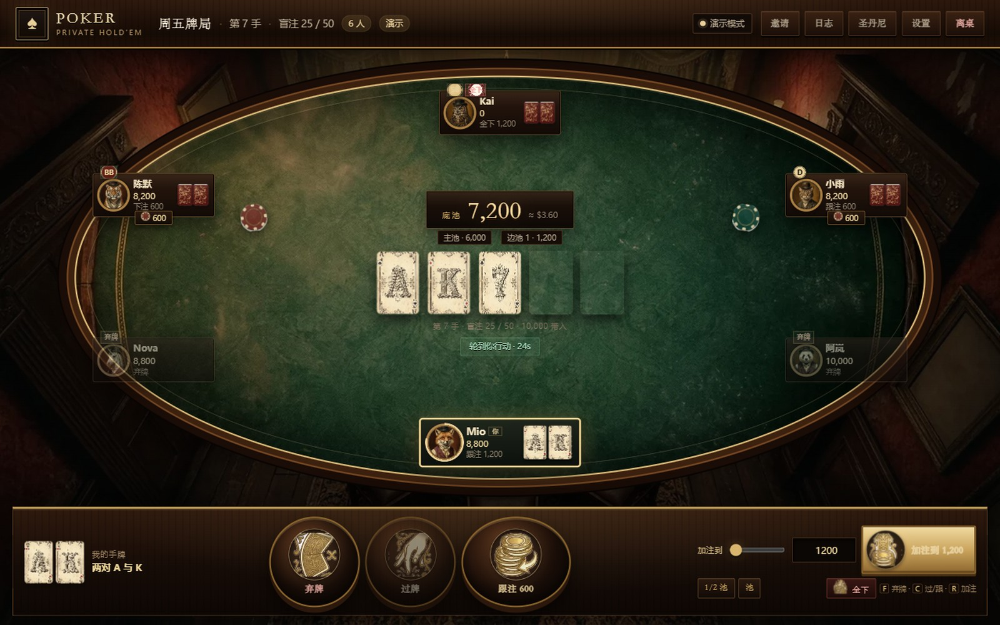

# magpie-poker

在 magpie 的窗口里开一桌德州扑克。玩家通过 Tailscale 直连，入桌时用 X25519 交换会话密钥；
筹码以 magpie gateway key 的额度结算：输家在自己机器上签发一把有额度、有有效期的短命 key，
赢家拿去用。

- magpie 页面插件（`magpie.page`），不需要单独装客户端
- 房主权威的无限注德州：盲注、单挑规则、最小加注、短 all-in、边池、摊牌分池、超时自动过牌/弃牌
- 牌桌服务是本机 Go 二进制（仅标准库），页面只和本机说话；牌桌流量走 Tailscale
- 结算不碰真钱：输家本机执行 `magpie gateway-key issue`，key 自带额度与 TTL





## 快速开始

要求：magpie ≥ 0.1.1340（有 page plugin 的版本），每台机器都装了 Tailscale 并登录同一 tailnet。
插件包自带 Windows / Linux / macOS 的 Go 服务二进制，运行时不需要 Go 或 Node。

```powershell
magpie plugin add github:iron-water/magpie-poker
# 本地开发：
# magpie plugin add C:\tmp\work\2026-11-24-magpie-poker
```

装好后重启一次 magpie，在 Work / Library 里打开「牌桌」。页面会自己跳到本机
`127.0.0.1:3481` 的服务（端口被占时插件会等旧宿主松手，最多 30 秒）。
如果页面停在「正在连接」，到 `magpie plugin on/off` 里重载一次，或重启 magpie。

### 开一桌

1. 填名字、盲注、带入筹码、人数、筹码单位（`cost` = 美元额度，`tokens` = 网关 token 数）、
   每筹码价格、行动秒数。
2. 点「开桌」。插件会**自动**用本机 Tailscale 把牌桌挂到
   `https://<机器名>.<tailnet>.ts.net:8443`，邀请码随之切换为 HTTPS 的 served 版本；
   不再需要手动点「共享牌桌」或复制 Tailscale IP。Tailscale 不可用时回退到直连邀请码。
3. 把邀请码发到群里。其他人打开牌桌页，粘贴邀请码加入；成员也不需要手动配地址。
4. 房主点「开始」发牌。

邀请码里含牌桌密钥，等于入场券：只发给这桌人。Tailscale 账号本身仍需安装并登录一次；
插件不能代替账号认证。若自动 Serve 失败，设置里「Serve 牌桌 :8443」仍可手动兜底。

### 结算

牌局结束后，每笔「输家 → 赢家」的结算会列出来：

- 输家点「签发 key」：本机自动确保有一把 `poker-bank` issuer key，然后执行
  `magpie gateway-key issue --from <issuer> --ttl 168h --cost <金额> --json`，把签出的 key 交给牌桌。
- 赢家点「复制」拿到 key，点「验证」用这把 key 请求输家的网关 `/v1/models`。
- 输家点「签发 key」时，插件会**自动**把自己的网关挂到
  `https://<机器名>.<tailnet>.ts.net:8444`（如果资料里还没有网关地址），
  签名前就把可达地址写进转账；设置里的「共享我的网关」是失败时的手动兜底。
- 额度单位是 `cost` 时用 `--cost`（美元，按 magpie 的价格估算），`tokens` 时用 `--tokens`。
- 低于最小结算额（默认 0.01）的转账标为 `small`，不签发。

key 是 bearer：只发给对应的赢家，建议用默认的 7 天 TTL（CLI 写 `168h`，magpie 的 TTL 不支持 `7d`）；到期自动失效。

## 两套皮肤

| 皮肤 | 来源 | 牌面 | 切换 |
|---|---|---|---|
| **鎏金象牙** | ChatGPT | 经典点阵，宫廷牌 + 雕版花色 | 顶部「鎏金」 |
| **圣丹尼** | Gemini | 大牌面，2–A 牌面 + 蜡封花色 | 顶部「圣丹尼」 |

也可以在设置里选，或直接开 `?skin=gilded` / `?skin=saintdenis`。两副牌的 52 张预览：
[鎏金象牙](docs/deck-gilded.jpg) · [圣丹尼](docs/deck-saintdenis.jpg)。



## 安全与边界

- **房主可信**：洗牌和底牌都在房主进程里，房主技术上能看所有人的底牌。这是朋友局，不是
  无信任的 mental poker。协议留了 commit-reveal 的位置，但没有实现。
- **邀请码是密钥**：拿到邀请码的人可以入桌；不要在公开频道贴。
- **Tailscale 负责传输加密**：牌桌协议另有 X25519 + HKDF 会话和每条请求的 HMAC，防止
  串桌、伪造和重放；它不替代 Tailscale 的 WireGuard。
- **key 是现金**：签发后不可撤回。输家本机的 `poker-bank` 只是一把 issuer，不需要它的
  secret 来签发；secret 由 magpie 保存，签发助手不会打印它。
- 本项目不处理真钱、不抽水、不做托管。不要用它参与赌博。

## 开发

```powershell
npm start            # go run ./cmd/magpie-poker --port 3481 --table-port 3482 --web-root .
npm test             # go test ./...，再跑皮肤素材完整性检查
```

单独构建、运行（二进制随插件分发，用户不需要装 Go）：

```powershell
go build -trimpath -ldflags "-s -w" -o bin/magpie-poker.exe ./cmd/magpie-poker
./bin/magpie-poker.exe --port 3481 --table-port 3482 --web-root .
```

跨平台产物：

```powershell
$env:GOOS="linux";  $env:GOARCH="amd64"; go build -trimpath -ldflags "-s -w" -o bin/magpie-poker-linux-amd64 ./cmd/magpie-poker
$env:GOOS="darwin"; $env:GOARCH="arm64"; go build -trimpath -ldflags "-s -w" -o bin/magpie-poker-darwin-arm64 ./cmd/magpie-poker
```

浏览器打开 `http://127.0.0.1:3481/?demo=1` 可以不连后端看牌桌和结算界面。

目录：

```
index.mjs                magpie 插件入口（启动 Go 服务）
cmd/magpie-poker/        CLI 与进程入口
internal/game/           牌、牌力、边池、无限注状态机
internal/eval/           7 张牌牌力评估
internal/netx/           邀请码、X25519、HKDF、签名、PeerClient
internal/peer/           对等会话（sign/verify/PeerClient）
internal/tableserver/    房主对等协议服务（HTTP + SSE）
internal/local/          本机 UI/API/SSE、Tailscale、结算、持久化
internal/store/          设置、host.json、牌桌快照
internal/magpiecli/      gateway-key / Tailscale CLI 封装
web/                     页面（无框架、无外部资源）
test/skins.test.mjs      两套皮肤 52 张牌面/牌背与 8 张头像的完整性检查
docs/API.md              页面 ⇄ 本地服务契约
docs/PROTOCOL.md         对等协议
docs/ASSETS.md           GPT Image 素材清单
```

## 已验证

- `npm test`：80 个 Go 测试（8 个包）——牌力评估（含 1 万手随机对拍）、边池、下注轮、
  单挑顺序、超时、结算守恒、X25519 握手、签名/重放、SSE 解析、房主/客户端端到端；
  外加两套皮肤各 52 张牌面/牌背 + 8 张头像的完整性检查。
- `go test -race`：game / peer / tableserver 三包通过。
- 真机本机双进程：Go 房主 + Go 客机，经 `POKER1.` 邀请码入桌，打完整手牌，结束牌桌，
  输家签出 key，赢家用 `/v1/models` 验证通过（magpie 0.1.4759）。
- 自动 Tailscale：开桌自动 `tailscale serve` 到 8443，邀请码切换为 `.ts.net` HTTPS（本机实测）；
  签发结算前自动 serve 网关到 8444（已接上，未在真实转账上重复验收）。
- UI：两套皮肤在 1280×800、960×640、390×844 实际渲染；控制台零错误；960px 以下动作栏换行。

## License

MIT
