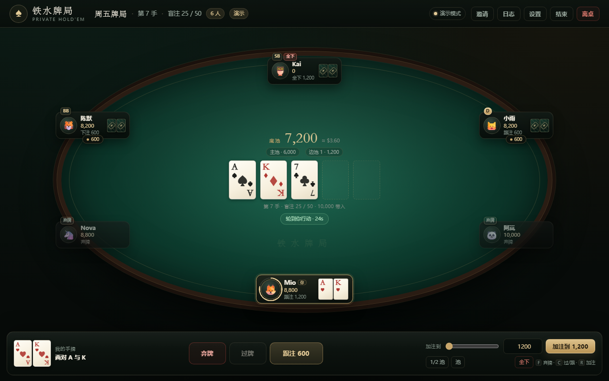

# magpie-poker

在 magpie 的窗口里开一桌德州扑克。玩家通过 Tailscale 直连，入桌时用 X25519 交换会话密钥；
筹码以 magpie gateway key 的额度结算：输家在自己机器上签发一把有额度、有有效期的短命 key，
赢家拿去用。

- magpie 页面插件（`magpie.page`），不需要单独装客户端
- 房主权威的无限注德州：盲注、单挑规则、最小加注、短 all-in、边池、摊牌分池、超时自动过牌/弃牌
- 每个玩家本地起服务，页面只和本机说话；牌桌流量走 Tailscale
- 结算不碰真钱：输家本机执行 `magpie gateway-key issue`，key 自带额度与 TTL



## 快速开始

要求：magpie ≥ 0.1.1340（有 page plugin 的版本），每台机器都装了 Tailscale 并登录同一 tailnet。

```powershell
magpie plugin add github:iron-water/magpie-poker
# 本地开发：
# magpie plugin add C:\tmp\work\2026-11-24-magpie-poker
```

装好后重启一次 magpie，在 Work / Library 里打开「牌桌」。页面会自己跳到本机
`127.0.0.1:3481` 的服务（端口被占时插件会等旧宿主松手，最多 30 秒）。
如果页面停在「正在连接」，到 `magpie plugin on/off` 里重载一次，或重启 magpie。

### 开一桌

1. 填名字、盲注、带入筹码、人数、筹码单位（`cost` = 美元额度，`tokens` = 网关 token 数）、
   每筹码价格、行动秒数。
2. 点「开桌」。右上角「邀请」给出邀请码（`POKER1.…`）。
3. 把邀请码发到群里。其他人打开牌桌页，粘贴邀请码加入。
4. 房主点「开始」发牌。

邀请码里含牌桌密钥，等于入场券：只发给这桌人。房间地址默认用本机的 Tailscale IP:3482。
如果对方连不上（Windows 防火墙默认拦入站），用「共享牌桌」按钮跑 Tailscale Serve，
改用 `https://<机器名>.<tailnet>.ts.net:8443` 的邀请码。

### 结算

牌局结束后，每笔「输家 → 赢家」的结算会列出来：

- 输家点「签发 key」：本机自动确保有一把 `poker-bank` issuer key，然后执行
  `magpie gateway-key issue --from <issuer> --ttl 168h --cost <金额> --json`，把签出的 key 交给牌桌。
- 赢家点「复制」拿到 key，点「验证」用这把 key 请求输家的网关 `/v1/models`。
- 输家需要先把自己的网关共享出去：设置里点「共享我的网关」，会跑
  `tailscale serve --bg --https=8444 http://127.0.0.1:<网关端口>`，并把
  `https://<机器名>.<tailnet>.ts.net:8444` 写进自己的资料。
- 额度单位是 `cost` 时用 `--cost`（美元，按 magpie 的价格估算），`tokens` 时用 `--tokens`。
- 低于最小结算额（默认 0.01）的转账标为 `small`，不签发。

key 是 bearer：只发给对应的赢家，建议用默认的 7 天 TTL（CLI 写 `168h`，magpie 的 TTL 不支持 `7d`）；到期自动失效。


## 安全与边界

- **房主可信**：洗牌和底牌都在房主进程里，房主技术上能看所有人的底牌。这是朋友局，不是
  无信任的 mental poker。协议留了 commit-reveal 的位置，但没有实现。
- **邀请码是密钥**：拿到邀请码的人可以入桌；不要在公开频道贴。
- **Tailscale 负责传输加密**：牌桌协议另有 X25519 + HKDF 会话和每条请求的 HMAC，防止
  串桌、伪造和重放；它不替代 Tailscale 的 WireGuard。
- **key 是现金**：签发后不可撤回。输家本机的 `poker-bank` 只是一把 issuer，不需要它的
  secret 来签发；secret 由 magpie 保存，签发助手不会打印它。
- 本项目不处理真钱、不抽水、不做托管。不要用它参与赌博。

## 开发

```powershell
npm start            # 独立起 UI 服务：http://127.0.0.1:3481
npm test             # node --test：牌力、边池、状态机、加密、对等协议、端到端
```

浏览器打开 `http://127.0.0.1:3481/?demo=1` 可以不连后端看牌桌和结算界面。

目录：

```
index.mjs               magpie 插件入口（server hook）
server/local-server.mjs 本机 UI + API + SSE
server/table-server.mjs 房主的对等协议服务
server/poker/           牌、牌力、边池、状态机
server/net/             邀请码、X25519、签名、PeerClient
server/magpie/          gateway-key / Tailscale CLI
web/                    页面（无框架、无外部资源）
docs/API.md             页面 ⇄ 本地服务契约
docs/PROTOCOL.md        对等协议
docs/ASSETS.md          GPT Image 素材清单
```

## 已验证

- `node --test`：牌力评估（含 1 万手随机对拍）、边池、下注轮、单挑顺序、超时、
  结算守恒、X25519 握手、签名/重放、SSE 解析、双进程端到端（建房 → 入桌 → 发牌 →
  行动 → 聊天 → 摊牌 → 结算）。
- 真机：magpie 0.1.4759 的页面插件宿主、`gateway-key issue` 签发与 `/v1/models` 验证
  （经 Tailscale IP 访问）。

## License

MIT
